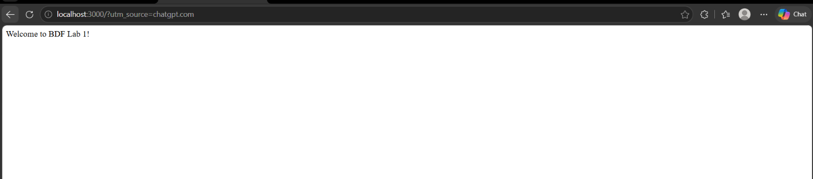
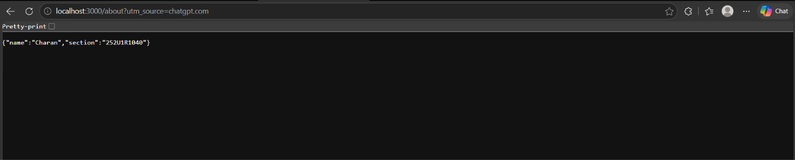
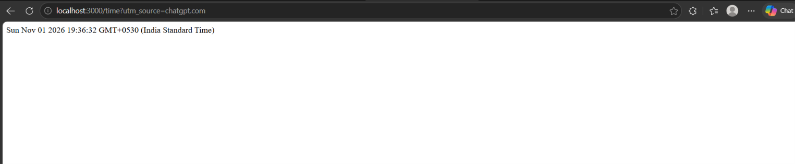
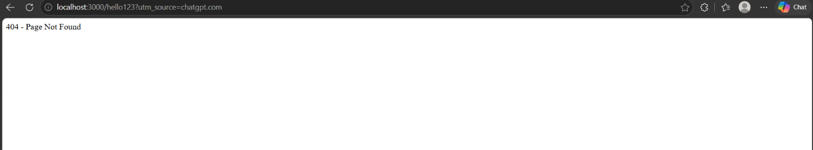

# BDF Lab 01 – Node.js and Express Server

**Student Name:** Charan  
**Registration Number:** 252U1R1040  
**Section:** S15  
**Course:** Backend Development Fundamentals  
**Lab:** Lab 01 – Node.js and Express Server  

**GitHub Repository:** https://github.com/Charan4545-hub/Charan---BDF

**Deployment URL:** Not Available – The application has been tested locally and public deployment has not been attempted.

---

## 1. Introduction

This project is developed as part of the Backend Development Fundamentals course. It demonstrates how to create a basic HTTP server using Node.js and how to build a server with multiple API endpoints using Express.js.

The project includes a basic HTTP server, three Express GET routes, and a custom 404 response for unknown URLs.

## 2. Objectives

- Initialize a Node.js project using npm.
- Understand the purpose of package.json.
- Install Express.js.
- Create an HTTP server using Node.js.
- Build API routes using Express.js.
- Return text, JSON, and dynamic date/time responses.
- Handle invalid routes with HTTP status code 404.

## 3. Technologies Used

- Node.js
- Express.js
- JavaScript
- npm
- Visual Studio Code
- Git and GitHub

## 4. Project Structure

```text
BDF-Lab-1/
│
├── Screenshots/
│   ├── About.png.png
│   ├── Home.png.png
│   ├── Time.png.png
│   └── Unknown.png.png
│
├── .gitignore
├── http-server.js
├── server.js
├── package.json
├── package-lock.json
└── README.md
```

**Note:** The node_modules folder is excluded from GitHub using .gitignore.

## 5. Installation

### Step 1: Clone the repository

```bash
git clone https://github.com/Charan4545-hub/Charan---BDF.git
```

### Step 2: Open the project folder

```bash
cd Charan---BDF
```

### Step 3: Install dependencies

```bash
npm install
```

## 6. Execution

### Run the Node.js HTTP Server

```bash
node http-server.js
```

Open the following URL in a browser:

http://localhost:3000

**Expected Output:**

```text
Hello
```

Stop the server using Ctrl + C before starting the Express server.

### Run the Express Server

```bash
node server.js
```

The Express application runs at:

http://localhost:3000

## 7. API Endpoints

| Method | Endpoint | Description | Status Code |
|---|---|---|---|
| GET | / | Displays a welcome message | 200 |
| GET | /about | Returns student details in JSON format | 200 |
| GET | /time | Returns current date and time | 200 |
| GET | /hello123 | Returns a page-not-found message | 404 |

## 8. Screenshots

### Home Endpoint



### About Endpoint



### Time Endpoint



### Unknown Route – 404



## 9. Testing

The application was tested locally by opening each endpoint in a web browser.

- The home route returned a welcome message.
- The about route returned student details in JSON format.
- The time route displayed the current date and time.
- The unknown route returned a 404 Page Not Found response.

All four endpoints were tested successfully.

## 10. Problems Faced and Solutions

**Problem 1:** Both the HTTP server and Express server use port 3000.

**Solution:** Stopped the running server using Ctrl + C before starting the next server.

**Problem 2:** Express requires dependencies to be installed.

**Solution:** Installed the required dependencies using npm install express.

## 11. Notes

- The application was developed and tested locally using Node.js and Visual Studio Code.
- The project runs locally on port 3000.
- No environment variables are required for local execution.
- The node_modules directory and .env files are excluded from GitHub.
- Public deployment has not been attempted.
- Screenshots of all four endpoints are included in the Screenshots folder.

## 12. Conclusion

This lab helped me understand how Node.js servers work and how Express.js simplifies backend development.

I successfully created a basic HTTP server and implemented Express routes for welcome messages, student details in JSON format, current date and time, and 404 error handling.

This practical exercise improved my understanding of backend server development and API routing using Node.js and Express.js.